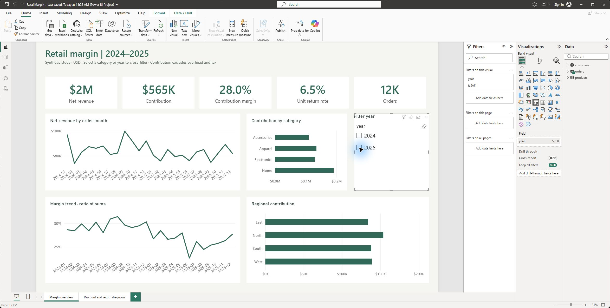
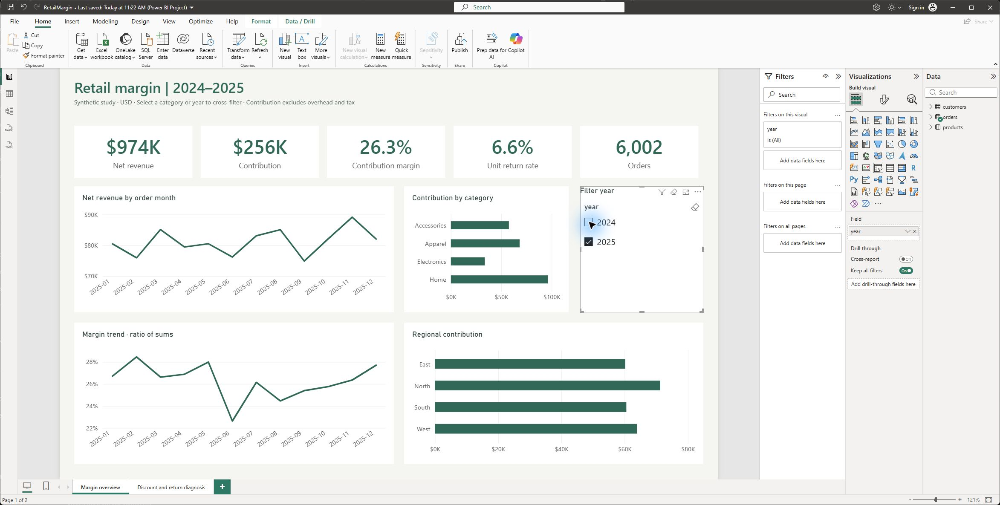
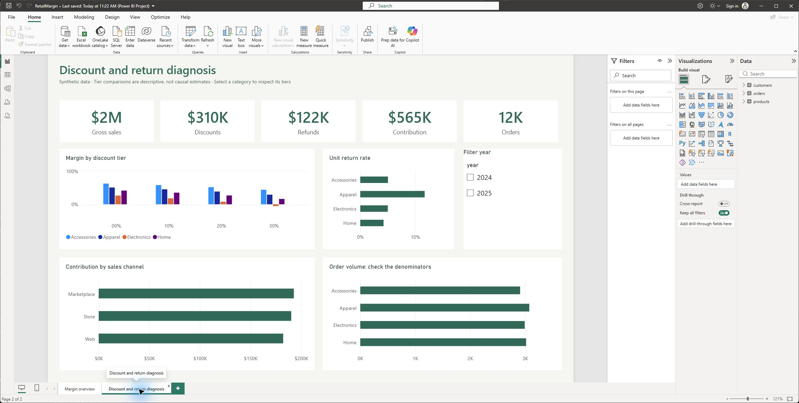
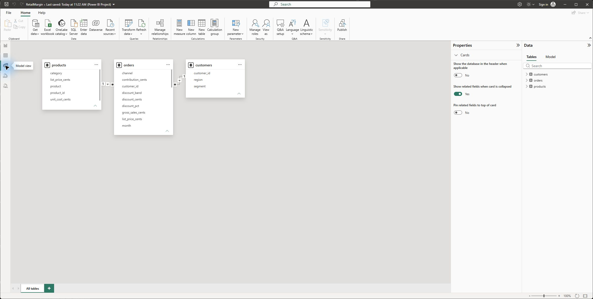
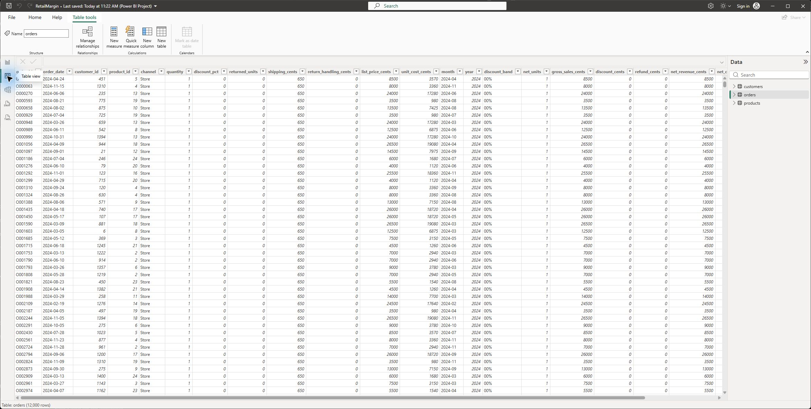

# Native Power BI captures

Captured on 2026-11-19 from the actual editable project in Power BI Desktop. All displayed records are synthetic.

## Overview

All 12,000 orders; contribution margin is a ratio of sums.

## 2025 filter

6,002 orders; 26.3% contribution margin. Compare with SQL 01.

## Discount diagnosis

Inspect category/tier differences and the order-volume denominators.

## Relationships

Products and customers filter the orders fact through many-to-one relationships.

## Loaded orders

12,000 clean order rows loaded in Power BI Desktop.

